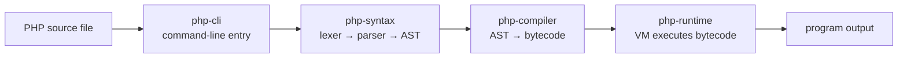

# php-rust

A Rust-written PHP runtime prototype. It reads PHP source, compiles the supported subset into internal bytecode, and runs it in the included VM. It provides both a command-line runner and an early HTTP server.

## Install

With Rust and Cargo installed, install the command from this project directory:

```sh
cargo install --path crates/php-cli --bins
```

Cargo places `php-rust` and `php-rust-server` in `~/.cargo/bin`. Ensure that directory is on `PATH`, then run a script:

```sh
php-rust examples/hello.php
php-rust --help
```

The machine that builds/installs the program needs Rust and Cargo. The installed executables are native and do not need PHP.

## Development

```sh
cargo run -p php-cli -- examples/hello.php
cargo run -p php-cli -- examples/control.php
cargo run -p php-cli -- examples/loops.php
cargo run -p php-cli -- examples/switch.php
cargo run -p php-cli -- examples/logical-operators.php
cargo run -p php-cli -- examples/word-logical-operators.php
cargo run -p php-cli -- examples/modulo.php
cargo run -p php-cli -- examples/string-functions.php
cargo run -p php-cli -- examples/ternary.php
cargo run -p php-cli -- examples/foreach.php
cargo run -p php-cli -- examples/arrays.php
cargo run -p php-cli -- examples/array-functions.php
cargo run -p php-cli -- examples/isset.php
cargo run -p php-cli -- examples/functions.php
cargo run -p php-cli -- examples/named-arguments.php
cargo run -p php-cli -- examples/classes.php
cargo run -p php-cli -- examples/namespaces.php
cargo run -p php-cli -- examples/references.php
cargo run -p php-cli -- examples/array-reference-arguments.php
cargo run -p php-cli -- examples/closures.php
cargo run -p php-cli -- examples/exceptions.php
cargo check --workspace
```

## Project structure

A PHP file passes through these layers when you run `php-rust examples/hello.php`:



## Web server

The workspace provides a Tokio-based asynchronous HTTP server. Socket accept/read/write work runs on Tokio's multi-thread runtime; PHP compilation and VM execution run on Tokio's blocking pool. Active connections are bounded to 128 by default. When that limit is reached, the server pauses accepting sockets so the operating system's bounded TCP listen backlog can queue a short burst; the backlog is requested at 1,024 connections and may be capped by the OS. It runs PHP scripts and a front controller, serves static files, and supplies common request globals:

```sh
mkdir -p public
cp examples/hello.php public/index.php
cargo run -p php-cli --bin php-rust-server -- --root public --bind 127.0.0.1:3000
```

Open `http://127.0.0.1:3000/`. Requests for existing files are served from `public`; missing routes are sent to `public/index.php`. `$_GET`, form/multipart `$_POST`, `$_COOKIE`, `$_REQUEST`, basic `$_FILES`, sessions, `php://input`, and common `$_SERVER` entries are initialized per request. PHP's `header()` and `http_response_code()` affect the HTTP response. Request bodies are capped at 2 MiB. The server is asynchronous for network I/O; VM execution remains synchronous and is isolated from the event loop using `spawn_blocking`. Multipart arrays, sessions, chunked requests, keep-alive, `100-continue`, `php://input`, and core JSON conversion are supported with documented limits. The server also enforces VM instruction and output limits and can shut down gracefully on SIGINT/SIGTERM. Static `include`/`require` paths are expanded for CLI and web execution; Composer PSR-4, PSR-0, classmap entries, and `autoload.files` are loaded from app and installed package manifests, with documented ordering limits. A limited PDO layer, SQL connection pools, and MongoDB document functions are available. PHP-FPM/FastCGI, direct HTTPS, and broad framework compatibility are not implemented yet. See the [web server guide](docs/web-server.md) and [database guide](docs/database.md).

Server settings can be kept in a PHP-INI-like `php-rust.ini` file; CLI flags override environment variables, which override file settings. See [the example config](php-rust.ini.example) and [configuration guide](docs/web-server.md#configuration).

### Feature map

| Feature | Syntax / AST | Compiler | Runtime |
| --- | --- | --- | --- |
| Arrays | [`parser/arrays/mod.rs`](crates/php-syntax/src/parser/arrays/mod.rs), [`ast/expressions/mod.rs`](crates/php-syntax/src/ast/expressions/mod.rs) | [`codegen/arrays/mod.rs`](crates/php-compiler/src/codegen/arrays/mod.rs) | [`values/array.rs`](crates/php-runtime/src/values/array.rs), [`vm/arrays.rs`](crates/php-runtime/src/vm/arrays.rs), [`array_builtins/`](crates/php-runtime/src/array_builtins/) |
| Control flow (`if`, `switch`, loops, numeric `break`/`continue`) | [`parser/statements/mod.rs`](crates/php-syntax/src/parser/statements/mod.rs), [`parser/control/mod.rs`](crates/php-syntax/src/parser/control/mod.rs), [`parser/loops/mod.rs`](crates/php-syntax/src/parser/loops/mod.rs), [`ast/statements/mod.rs`](crates/php-syntax/src/ast/statements/mod.rs) | [`codegen/statements/mod.rs`](crates/php-compiler/src/codegen/statements/mod.rs), [`codegen/control/mod.rs`](crates/php-compiler/src/codegen/control/mod.rs), [`codegen/loops/mod.rs`](crates/php-compiler/src/codegen/loops/mod.rs) | [`vm/control.rs`](crates/php-runtime/src/vm/control.rs), [`vm/mod.rs`](crates/php-runtime/src/vm/mod.rs) |
| Expressions (`!`, `&&`, `||`, ternary `?:`) | [`lexer/mod.rs`](crates/php-syntax/src/lexer/mod.rs), [`parser/expressions/mod.rs`](crates/php-syntax/src/parser/expressions/mod.rs), [`ast/expressions/mod.rs`](crates/php-syntax/src/ast/expressions/mod.rs) | [`codegen/expressions/mod.rs`](crates/php-compiler/src/codegen/expressions/mod.rs) | [`vm/mod.rs`](crates/php-runtime/src/vm/mod.rs) |
| Functions and calls | [`parser/functions/mod.rs`](crates/php-syntax/src/parser/functions/mod.rs), [`ast/functions/mod.rs`](crates/php-syntax/src/ast/functions/mod.rs) | [`declarations/functions/mod.rs`](crates/php-compiler/src/codegen/declarations/functions/mod.rs) | [`vm/functions.rs`](crates/php-runtime/src/vm/functions.rs) |
| References | [`ast/functions/mod.rs`](crates/php-syntax/src/ast/functions/mod.rs), [`parser/functions/mod.rs`](crates/php-syntax/src/parser/functions/mod.rs) | [`declarations/functions/mod.rs`](crates/php-compiler/src/codegen/declarations/functions/mod.rs) | [`vm/functions.rs`](crates/php-runtime/src/vm/functions.rs) |
| Closures | [`parser/functions/mod.rs`](crates/php-syntax/src/parser/functions/mod.rs), [`ast/expressions/mod.rs`](crates/php-syntax/src/ast/expressions/mod.rs) | [`codegen/expressions/mod.rs`](crates/php-compiler/src/codegen/expressions/mod.rs) | [`values/value.rs`](crates/php-runtime/src/values/value.rs), [`vm/functions.rs`](crates/php-runtime/src/vm/functions.rs) |
| Exceptions | [`parser/statements/mod.rs`](crates/php-syntax/src/parser/statements/mod.rs), [`ast/statements/mod.rs`](crates/php-syntax/src/ast/statements/mod.rs) | [`codegen/statements/mod.rs`](crates/php-compiler/src/codegen/statements/mod.rs) | [`bytecode/mod.rs`](crates/php-runtime/src/bytecode/mod.rs), [`vm/mod.rs`](crates/php-runtime/src/vm/mod.rs) |
| Namespaces | [`parser/declarations/mod.rs`](crates/php-syntax/src/parser/declarations/mod.rs), [`parser/mod.rs`](crates/php-syntax/src/parser/mod.rs) | [`declarations/functions/mod.rs`](crates/php-compiler/src/codegen/declarations/functions/mod.rs), [`declarations/classes/mod.rs`](crates/php-compiler/src/codegen/declarations/classes/mod.rs) | [`vm/functions.rs`](crates/php-runtime/src/vm/functions.rs), [`vm/objects.rs`](crates/php-runtime/src/vm/objects.rs) |
| Classes, interfaces, traits | [`parser/declarations/mod.rs`](crates/php-syntax/src/parser/declarations/mod.rs), [`ast/classes/mod.rs`](crates/php-syntax/src/ast/classes/mod.rs), [`ast/interfaces/mod.rs`](crates/php-syntax/src/ast/interfaces/mod.rs), [`ast/traits/mod.rs`](crates/php-syntax/src/ast/traits/mod.rs) | [`declarations/classes/mod.rs`](crates/php-compiler/src/codegen/declarations/classes/mod.rs) | [`values/object.rs`](crates/php-runtime/src/values/object.rs), [`vm/objects.rs`](crates/php-runtime/src/vm/objects.rs) |
| CLI and HTTP server entry points | — | — | [`php-cli/src/main.rs`](crates/php-cli/src/main.rs), [`php-cli/src/server.rs`](crates/php-cli/src/server.rs) |

- `crates/php-syntax/src/ast/` — AST domains grouped into expressions, statements, functions, classes, interfaces, traits, and programs
- `crates/php-syntax/src/lexer/` — source lexer and token definitions
- `crates/php-syntax/src/parser/` — shared parser state plus domain folders for expressions, statements, declarations, functions, loops, control flow, and arrays
- `crates/php-compiler/src/codegen/` — separate expression, statement, declaration, and switch bytecode generation
- `crates/php-runtime/src/values/` — array, object, and scalar runtime values grouped by data type
- `crates/php-runtime/src/array_builtins/` — dispatcher plus separate query, construction, transform, callback, mutation, sorting, and shared-helper modules for PHP array functions
- `crates/php-runtime/src/vm/` — shared execution loop plus separate array, control-flow, function/call, object, and operator instruction handlers
- `crates/php-runtime/src/bytecode/mod.rs` — instruction definitions
- `crates/php-cli/` — standalone command-line executable
- `Cargo.toml` — workspace and shared dependency definitions
- `Cargo.lock` — pinned dependency graph

## Supported subset

PHP tags, line and hash comments, variables, `global` and function-local `static` (including dynamic expression initializers), assignment expressions and compound variable assignments (including basic `$$name` variable variables), simple variable aliases and live by-reference parameters for variables and computed array offsets in functions/methods/constructors/closures, by-reference closure captures, `echo`/`print`, strings, numbers, booleans, null, arithmetic including exponentiation (`**` and `**=`), integer modulo `%` and `%=`, concatenation, comparisons, short-circuit `&&`/`||` and word-form `and`/`or`/`xor`, `??`, unary `!`, full and shorthand ternary expressions, `if`/`else`, `switch`/`case`/`default` with fall-through, `while`, `do...while`, `for`, `foreach`, one file-level `namespace Name;` declaration with simple class/function imports, variadic parameters, named arguments for user-defined callables and implemented array/HTTP built-ins, closures, arrow functions, and static closures, explicit `throw`, typed `try`/`catch` and `finally`, numeric `break`/`continue`, prefix/postfix variable increment/decrement, numeric and associative arrays with unpacking and positional/keyed/nested destructuring, nested array reads/writes/appends, `unset`, user-defined functions, recursion, and a growing OOP subset with inheritance, static members, visibility, typed/readonly properties, class constants, abstract/final classes and methods, interfaces with constants and typed parameter/return contracts with class variance, traits with conflict selection and aliases, object cloning and `__clone()`, `__get()`/`__set()`/`__isset()`/`__unset()`/`__call()`/`__callStatic()`/`__toString()`, plus a growing subset of PHP array functions. See [array compatibility](docs/array-compatibility.md) for implemented functions and known gaps, and [compiler architecture](docs/compiler-architecture.md) for OOP coverage and gaps.

Syntax and lexer errors include source line and column. Namespaces, references, closures, and exceptions are partial subsets; the runtime does not yet support full PHP semantics for them. Array unpacking and positional/keyed/nested literal `list()`/short-array destructuring are supported, including computed destructuring keys and object-property destinations. Global and namespaced constants are supported, with a limited set of built-in constants. Most of the standard library, extensions, PHP-FPM, and broad PHP application compatibility remain unsupported. The HTTP server prototype is described above.

Implemented string builtins include `strlen()`, case conversion, `trim()`, `ltrim()`, `rtrim()`, `str_repeat()`, `str_split()`, `strpos()`, `substr()`, `explode()`, `implode()`, HTML escaping, `str_contains()`, `str_starts_with()`, `str_ends_with()`, string comparisons, `strrev()`, `str_replace()`, and `str_ireplace()`. `json_encode()` and `json_decode()` cover scalar, array, basic object, and backed enum values. Common encode/decode flags, partial output, throw mode, bigint handling, and pure enum error reporting are supported; exact error classification and invalid-byte handling remain partial. See [function support](docs/functions.md) for the current limits.

## Documentation

Start at the [documentation index](docs/README.md). Feature-specific guides cover [build, install, and test](docs/testing.md), [syntax and parsing](docs/syntax-and-parser.md), [control flow and loops](docs/control-flow.md), [functions](docs/functions.md), [OOP support and gaps](docs/oop-compatibility.md), [arrays](docs/array-compatibility.md), [database connections](docs/database.md), [runtime and bytecode](docs/runtime-and-bytecode.md), [CLI and installation](docs/cli-and-installation.md), and [development workflow](docs/development.md).

## Build a user-installable Linux package

The release maintainer creates a prebuilt Linux x86_64 archive with:

```sh
./scripts/package-linux.sh
```

This writes `dist/php-rust-<version>-linux-x86_64.tar.gz`. The recipient does not need Rust or Cargo. After extracting it, they install for their user with:

```sh
./install.sh
```

The installer places the executable in `~/.local/bin`. Pass `--prefix DIR` to choose another install location. Linux packages for other CPU architectures and macOS/Windows installers still need to be produced separately.

## Build and run a versioned Docker image

`./scripts/docker-build.sh` builds `php-rust:<version>` using the version in `Cargo.toml`. Run it against an application with `public/index.php` using `./scripts/docker-run.sh /path/to/app 3000`. Run `./scripts/docker-laravel-check.sh` to build the image, verify its version label, create a fresh Laravel app, and request its `/up` route in one command. See [the Docker and Laravel test guide](docs/testing.md#5-build-and-run-a-versioned-docker-image); a successful image build does not by itself establish Laravel compatibility.
